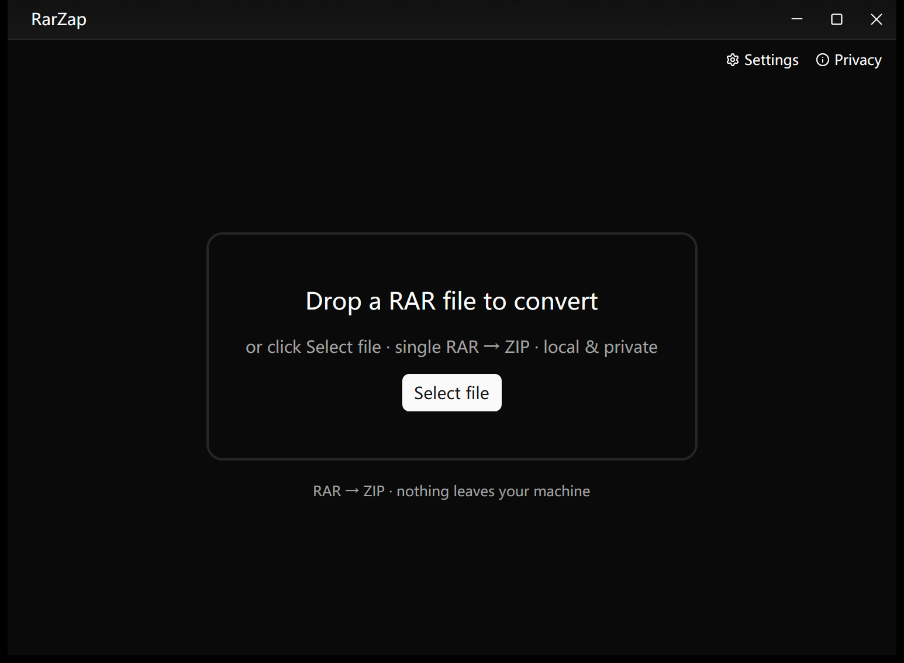
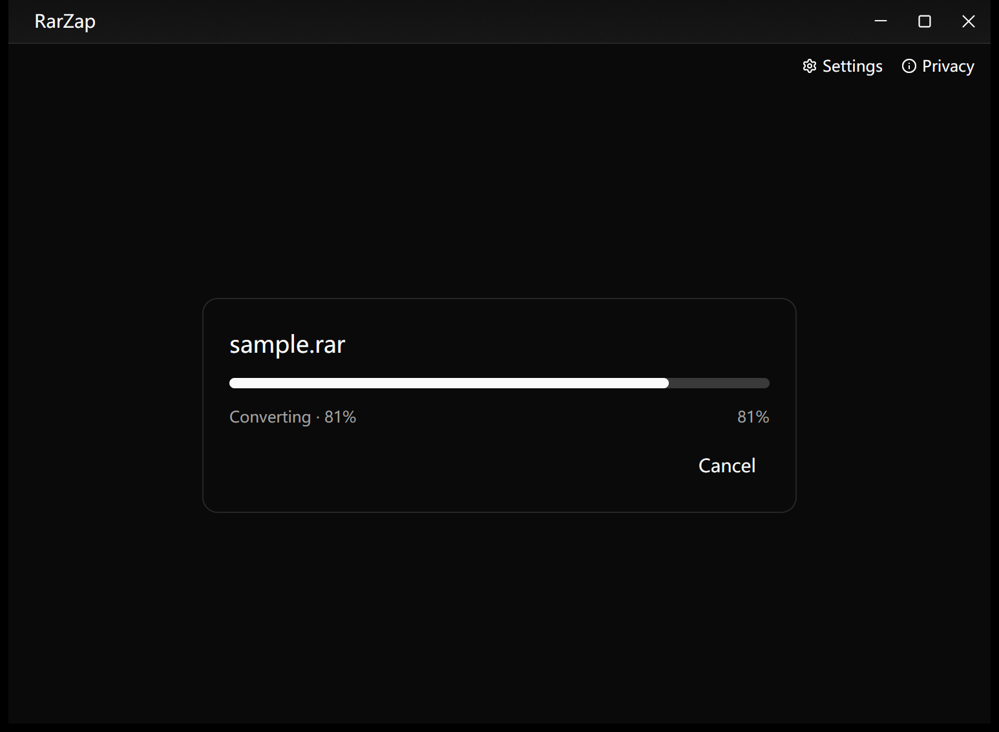
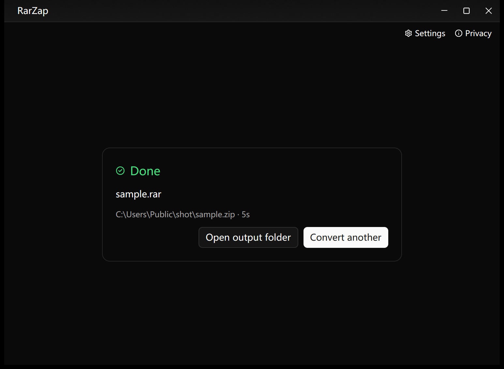
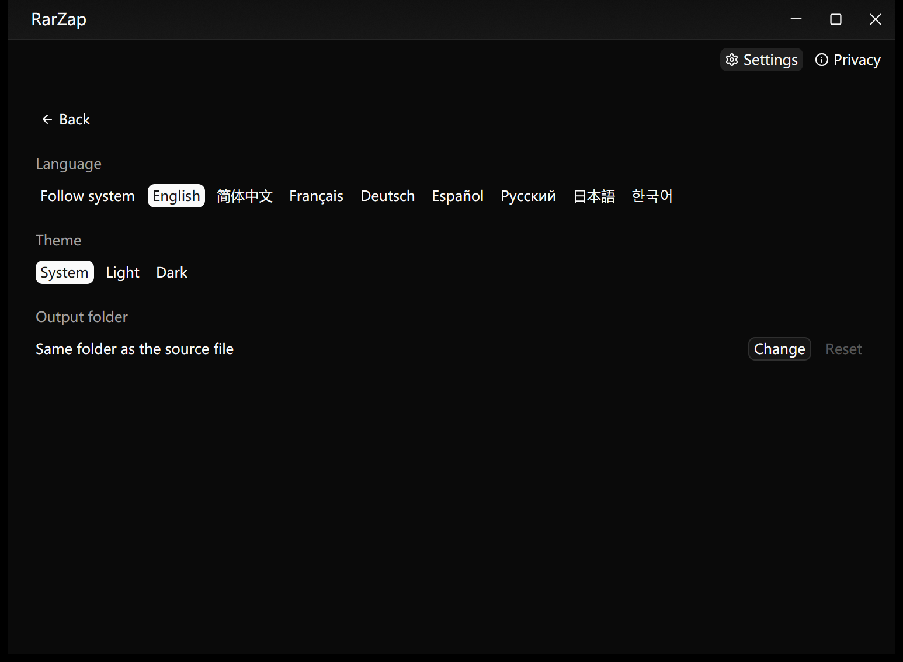
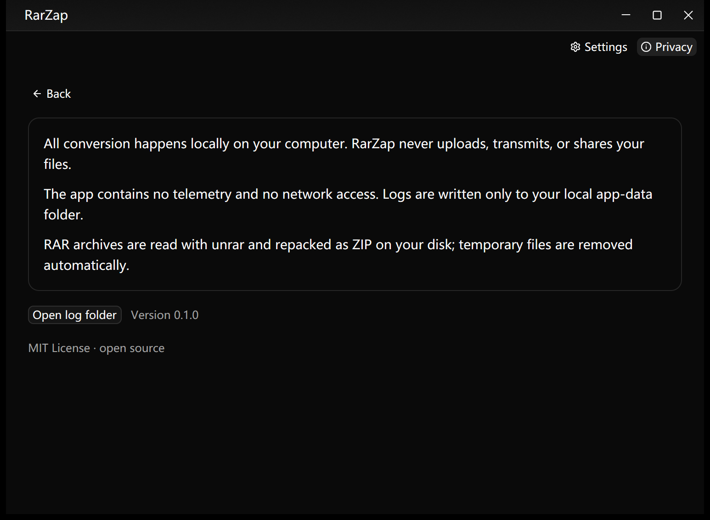

<div align="center">

# RarZap

**Fast, local RAR → ZIP converter for the desktop.**

[](https://github.com/indmak/RarZap/actions/workflows/ci.yml)
[](LICENSE-MIT)
[]()

[Official site](https://www.indmak.com/products/rarzap) · [Releases](https://github.com/indmak/RarZap/releases) · [Report a bug](https://github.com/indmak/RarZap/issues)

</div>



> Screenshot: real app window (empty state, English).

| Converting | Done | Settings | Privacy |
|---|---|---|---|
|  |  |  |  |

## What it is

RarZap converts **RAR archives to ZIP** — locally, privately, nothing uploaded.
RAR is read-only by design (proprietary format), so the flow is
**extract RAR → repack as ZIP (Deflate, maximum compatibility)**.

- 🖥️ **Native desktop UI** — GPU-rendered, no WebView, no Electron.
- 🔒 **Local & private** — files never leave your machine.
- 🌍 **8 languages** — English (default), Français, Deutsch, Español,
  Русский, 日本語, 한국어, 简体中文. Follows the OS language automatically.
- 🎨 **Calm UI** — quiet surfaces, stage-driven layout, dark-mode ready.

### Free vs commercial

| | Free (this repo, MIT) | Commercial plugin |
|---|---|---|
| Single RAR → ZIP | ✅ | ✅ |
| Batch / queue conversion | — | ✅ (`plugins/`, local build) |
| Microsoft Store edition | — | ✅ store build only |

The open-source tree contains **zero paywall code** — there is no locked
batch entry, only single-file conversion. Batch lives in the local-only
`plugins/` directory and is distributed via the Microsoft Store build.

## Install

| Platform | Package |
|---|---|
| Windows | `RarZap-<ver>-setup.exe` from [Releases](https://github.com/indmak/RarZap/releases) (Inno Setup, with uninstaller) |
| macOS | `RarZap-<ver>.dmg` — drag to Applications (signed + notarized when release secrets are present) |
| Linux (Debian/Ubuntu) | `rarzap_<ver>_amd64.deb` |

The Windows installer is currently **unsigned** (SignPath open-source plan
pending); macOS builds are signed + notarized with the project's Developer ID
account once release secrets are configured — otherwise CI skips that step.

## Usage

1. **Drop a `.rar` file anywhere on the window** — or click **Select file**.
2. Conversion runs on a background thread; the UI stays fluid and shows
   **real progress** (extraction is file-by-file, packing is byte-by-byte).
3. On success: **Open output folder** to reveal the `.zip` next to the source
   (or in the output folder set in **Settings**).

**Settings** — language (follow system + 8 locales), theme
(system / light / dark), output folder. All persisted to `config.json`.

**Privacy** — the app converts locally, contains no telemetry and no network
access; the privacy page links to the local log folder.

Output is **atomic**: the `.zip` appears only on success; cancelled or failed
runs leave no half-written files behind (staging happens on the same disk as
the target, then renames into place).

### Keyboard / window

Custom title bar with working **drag, double-click maximize, minimize,
maximize/restore and close** buttons on all three platforms.

**Settings** and **Privacy** live in a slim toolbar row just under the title
bar (labelled buttons, so they are unambiguous and reliably clickable — on
Windows the OS treats the title-bar strip itself as a drag caption, which
swallows clicks on controls placed inside it).

## Build from source

Requires **Rust 1.92+** and (Linux) the GTK/Wayland/Vulkan dev packages —
see [`.github/workflows/ci.yml`](.github/workflows/ci.yml) for the exact list.

```bash
cargo build --release --locked
cargo test --locked
```

Regenerate icons from the single hand-drawn source (`docs-zh/logo-rar.png`):

```bash
cargo run --example generate_icons
```

Real-window screenshot helper (DPI-aware), including settings/privacy:

```powershell
powershell -ExecutionPolicy Bypass -File scripts/screenshot.ps1 -Out out.png -Screen settings
```

Headless conversion (verifies the whole pipeline without the GUI):

```bash
cargo run --example convert -- path/to/file.rar [output_dir]
```

Smoke affordances (used by the screenshot script):

- `RARZAP_START_SCREEN=settings|privacy` — open a specific page at launch.
- `RARZAP_OPEN=<file.rar>` — start converting that file right after launch.

End-to-end tests (need a real archive):

```powershell
$env:RARZAP_TEST_RAR="C:\path\sample.rar"
cargo test --test convert_e2e -- --ignored --nocapture
```

### Versioning

One source of truth: `[package] version` in the root `Cargo.toml`.
After bumping it, run `scripts/sync-version.ps1` — it aligns the commercial
plugin version and prints the derived 4-part Microsoft Store version
(`0.1.0` → `0.1.0.0`).

## Architecture

```text
src/
  core/     CORE: single-file RAR→ZIP primitive + RarzapPlugin trait (no runtime, no batch)
  free/     Free feature: single-file plan/run service
  ui/       Free UI: Empty / Working / Done (GPUI Kit)
  i18n.rs   8-locale setup (rust-i18n, compiled-in YAML)
plugins/    Commercial batch plugin — LOCAL ONLY, git-ignored (whole directory)
packaging/  Inno Setup (.iss) · macOS (.plist + make-app.sh) · Debian (.deb builder)
```

Plugin contract (`src/core/plugin.rs`): `RarzapPlugin` with `JobSpec` /
`JobOutcome` / `ProgressEvent`. CORE never knows about queues, semaphores or
cancellation tokens — those are plugin internals. Cancellation crosses the
boundary as a plain `&dyn Fn() -> bool` probe, so CORE stays runtime-free.

Tech stack: [GPUI Kit](https://gpui-kit.com) (`gpui-kit` + `gpui-component`,
latest) · `unrar-ng` (extract) · `zip` crate (Deflate pack) ·
`tracing` (daily-rotated logs) · `anyhow` + `thiserror` (layered errors).

## Contributing

Issues and PRs welcome. Please keep the free tree free of batch/paywall
code — batch belongs in `plugins/`. See [`docs-zh/`](docs-zh/) (Chinese) for
the original UI/tech/batch planning docs.

## License

[MIT](LICENSE-MIT) — do what you want, keep the notice.
